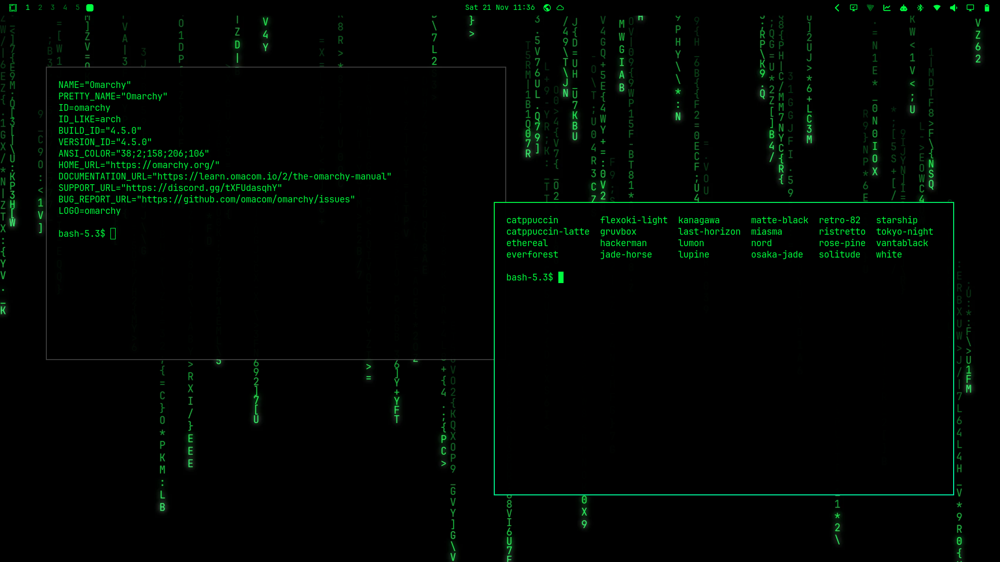

# Matrix Rain

The Matrix digital-rain aesthetic for [Omarchy](https://omarchy.org): phosphor
green on pure black, from the bar and borders down to the terminal palette.



## Install

```sh
omarchy theme install matrix-rain
```

Or from the repository directly:

```sh
omarchy theme install https://github.com/DjSurfsand/omarchy-matrix-rain-theme
```

Then pick **Matrix Rain** under Style → Themes, or `omarchy theme set matrix-rain`.

## What's inside

- `colors.toml` — a full dark palette built around `#00ff41` phosphor green:
  green-tinted foregrounds, a green gradient for the active window border, and
  ANSI colors remapped into the green family so terminal output stays on-theme.
- `backgrounds/` — two original wallpapers generated for this theme: a dense
  falling-code field and a sparser variant. The first is applied with the
  theme; cycle to the second with `omarchy theme bg next`.

## Pairs with the Matrix Rain app

For live animated rain behind your windows, install the companion app
[Matrix Rain](https://github.com/DjSurfsand/matrixrain) — a transparent
layer-shell surface that follows this theme's accent (and any other Omarchy
theme) in real time.

## License

MIT — see [LICENSE](LICENSE). Wallpapers are original works generated for this
theme.
